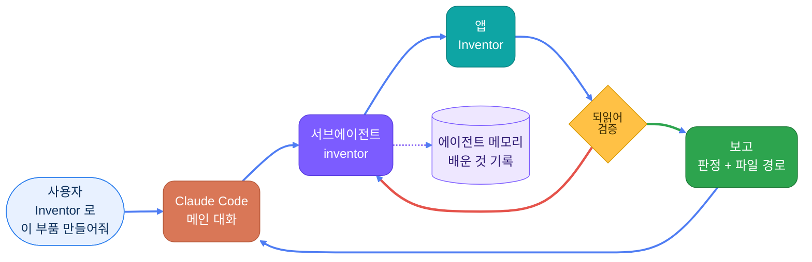

<div align="center">

# Subagents

**연구 전용 Claude Code 서브에이전트**

   

논문 그래프·CAD 모델링·광학 시뮬레이션처럼 Windows 데스크톱 앱을 다루는 일을 맡기면,<br>
에이전트가 앱을 직접 다루고 결과를 스스로 검증한 뒤 보고합니다.

</div>

> 💡 AI 에이전트에게 설치를 맡기려면: "github.com/ohh000410/subagents 의 AGENTS.md 를 읽고 필요한 에이전트를 설치해줘"

<br>

## 이렇게 일합니다



검증을 통과하면(초록) 판정과 파일 경로를 보고하고, 실패하면(빨강) 원인을 고쳐 다시 합니다. 쓰면서 배운 것은 에이전트 메모리에 남깁니다(보라 점선).

<br>

## 에이전트

### 📄 문서·그림

<table>
<thead><tr><th width="28%">에이전트</th><th width="72%">하는 일</th><th>필요한 앱</th></tr></thead>
<tbody>
<tr><td nowrap><a href="plugins/doc-scan/README.md">doc-scan</a></td><td>문서 사진을 스캔본·PDF 로 만듭니다</td><td nowrap>없음</td></tr>
<tr><td nowrap><a href="plugins/plot-digitizer/README.md">plot-digitizer</a></td><td>그래프 이미지에서 수치를 뽑습니다</td><td nowrap>웹 브라우저</td></tr>
<tr><td nowrap><a href="plugins/pptx-figure/README.md">pptx-figure</a></td><td>PowerPoint 도형으로 그림을 그립니다</td><td nowrap>PowerPoint</td></tr>
<tr><td nowrap><a href="plugins/origin-plot/README.md">origin-plot</a></td><td>논문 형식 그래프를 그립니다</td><td nowrap>Origin 2019</td></tr>
</tbody>
</table>

### 🛠️ CAD·광학

<table>
<thead><tr><th width="28%">에이전트</th><th width="72%">하는 일</th><th>필요한 앱</th></tr></thead>
<tbody>
<tr><td nowrap><a href="plugins/inventor/README.md">inventor</a></td><td>부품 3D 모델과 2D 도면을 만듭니다</td><td nowrap>Inventor 2027</td></tr>
<tr><td nowrap><a href="plugins/spaceclaim/README.md">spaceclaim</a></td><td>SPEOS·ANSYS 용 형상을 만듭니다</td><td nowrap>SpaceClaim v261</td></tr>
<tr><td nowrap><a href="plugins/speos/README.md">speos</a></td><td>광학 시뮬레이션을 돌리고 정리합니다</td><td nowrap>SPEOS v261</td></tr>
</tbody>
</table>

### 🔬 시뮬레이션·계산

<table>
<thead><tr><th width="28%">에이전트</th><th width="72%">하는 일</th><th>필요한 앱</th></tr></thead>
<tbody>
<tr><td nowrap><a href="plugins/lumerical/README.md">lumerical</a></td><td>FDTD·RCWA 시뮬레이션을 돌립니다</td><td nowrap>Lumerical v242</td></tr>
<tr><td nowrap><a href="plugins/research-compute/README.md">research-compute</a></td><td>RCWA·산란·원거리장 복사 열전달</td><td nowrap>없음</td></tr>
</tbody>
</table>

<br>

## 빠른 시작

Claude Code 안에서:

```
/plugin marketplace add ohh000410/subagents
/plugin install inventor@ohh000410-subagents
```

`inventor` 자리에 원하는 에이전트 이름을 넣습니다. 설치한 뒤 새 대화에서 "Inventor 로 이 부품 만들어줘"처럼 말하면 Claude 가 그 에이전트에게 맡깁니다.

<br>

## 쓰는 방식

- **상담과 실행:** 실행하라고 하지 않으면 상담만 합니다. 앱을 띄우거나 파일을 만들지 않고 진단과 코드만 줍니다.
- **검증:** 실행하면 결과를 되읽어 확인하고, 판정(PASS·WARN·FAIL)과 파일 경로를 보고합니다.
- **메모리:** 쓰면서 알게 된 것(이 PC 의 환경 값, 오류와 해결법, 걸린 시간)을 Claude 에이전트 메모리(`~/.claude/agent-memory/<플러그인>-<에이전트>/`)에 스스로 기록합니다. 처음에는 비어 있습니다.
- **시작 훅:** 에이전트 파일은 이름·설명만 담은 껍데기이고, 에이전트가 뜰 때 플러그인 훅이 공통 규칙과 본문을 넣습니다(그 에이전트가 뜰 때만). 작성자가 실제로 쓰는 하네스와 같은 구조라, 앞으로 공개할 메모리 체계와 여러 하네스 동시 운용도 이 훅에 얹습니다.

<br>

## 필요한 것

- Windows 와 Claude Code — 지금은 Windows 전용입니다(시작 훅이 Windows PowerShell 로 돕니다). Windows 앱이 필요 없는 에이전트(doc-scan·plot-digitizer 등)는 훅 실행 방식만 바꾸면 되므로 추후 Linux·macOS 로 넓힐 수 있습니다.
- 쓰려는 에이전트가 다루는 앱(위 표의 "필요한 앱")
- Python. 에이전트마다 필요한 패키지와 앱 설치 경로는 각 에이전트 README 의 "필요한 것"에 있고, 경로가 다르면 처음 쓸 때 에이전트가 묻습니다.

<br>

## 라이선스

이 저장소의 파일(에이전트 지시문·references·도구)은 MIT 라이선스입니다(`LICENSE`). 에이전트가 다루는 앱(Inventor, Ansys SpaceClaim·SPEOS·Lumerical, Origin, PowerPoint)과 도구가 쓰는 Python 패키지는 들어 있지 않으며, 각자의 라이선스로 설치하고 그 약관을 따라야 합니다.
